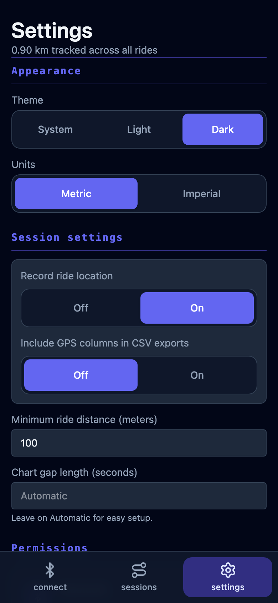

# Float View

Connect to your VESC board over Bluetooth, watch live telemetry, record rides,
and tune Refloat. Available on macOS, Android, and iOS.

<table>
  <tr>
    <td align="center" valign="top" width="33%">
      <strong>Live dashboard</strong><br>
      <a href="docs/screenshots/live.png"></a>
    </td>
    <td align="center" valign="top" width="33%">
      <strong>Live charts</strong><br>
      <a href="docs/screenshots/live-charts.png"></a>
    </td>
    <td align="center" valign="top" width="33%">
      <strong>Battery management</strong><br>
      <a href="docs/screenshots/bms.png"></a>
    </td>
  </tr>
  <tr>
    <td align="center" valign="top" width="33%">
      <strong>Ride history</strong><br>
      <a href="docs/screenshots/session.png"></a>
    </td>
    <td align="center" valign="top" width="33%">
      <strong>Board configuration</strong><br>
      <a href="docs/screenshots/board-configuration.png"></a>
    </td>
    <td align="center" valign="top" width="33%">
      <strong>App settings</strong><br>
      <a href="docs/screenshots/settings.png"></a>
    </td>
  </tr>
</table>

_Recorded ride data with a simulated live connection and BMS cell readings._

## How to install

Download the latest build from the [releases page](https://github.com/acheronfail/float-view-mobile/releases).

### macOS

Requires macOS 14 or later. Supports Apple Silicon and Intel.

1. Download the macOS `.zip`, extract it, and move `FloatView.app` to Applications.
2. The app isn't notarised. Run this once in Terminal to allow it through Gatekeeper:

   ```sh
   xattr -dr com.apple.quarantine /Applications/FloatView.app
   ```

3. Open FloatView.

### Android

Download the `.apk`, open it on your phone, and tap **Install**.
Allow installation from this source if Android asks.

### iOS

For now, use [AltStore Classic](https://faq.altstore.io/altstore-classic).

1. Install AltStore Classic using its linked guide (requires a Mac or PC).
2. Download the `.ipa` on your iPhone.
3. In AltStore, open **My Apps**, tap **+**, and select the IPA.

With a free Apple account, [refresh the app every seven days](https://faq.altstore.io/altstore-classic/your-altstore).

## Contributing

See [CONTRIBUTING.md](CONTRIBUTING.md) for development and verification instructions.
