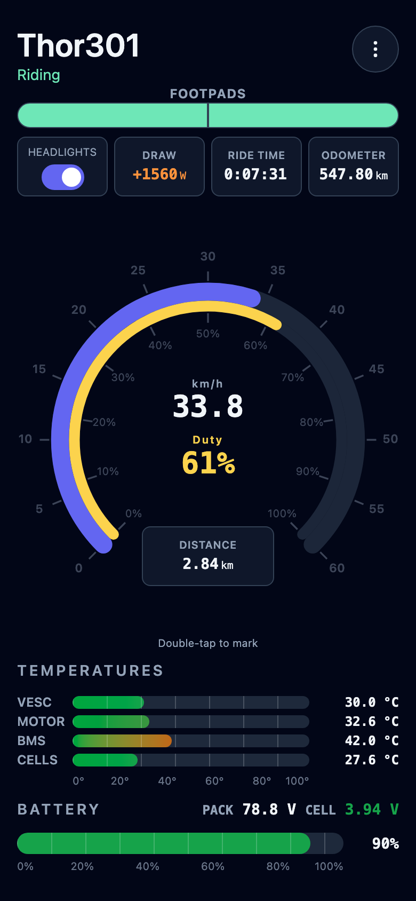
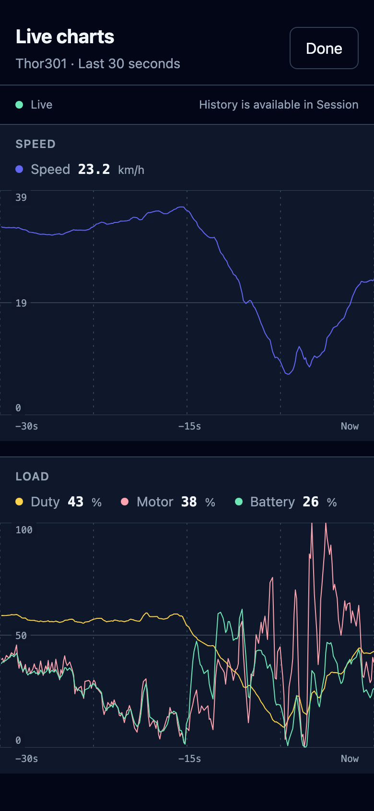
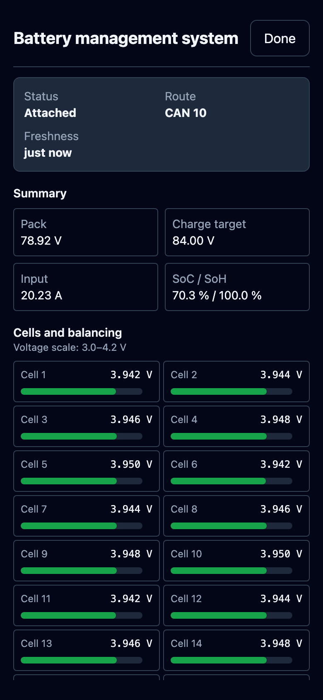
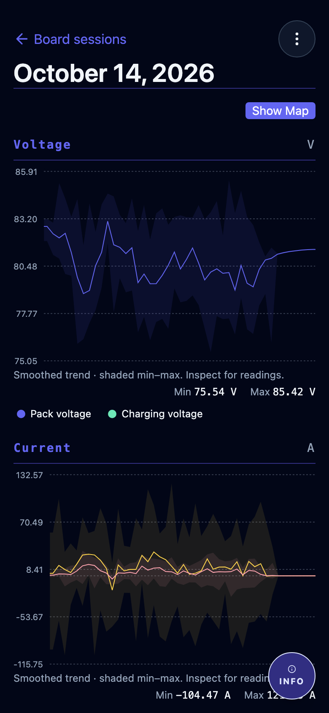
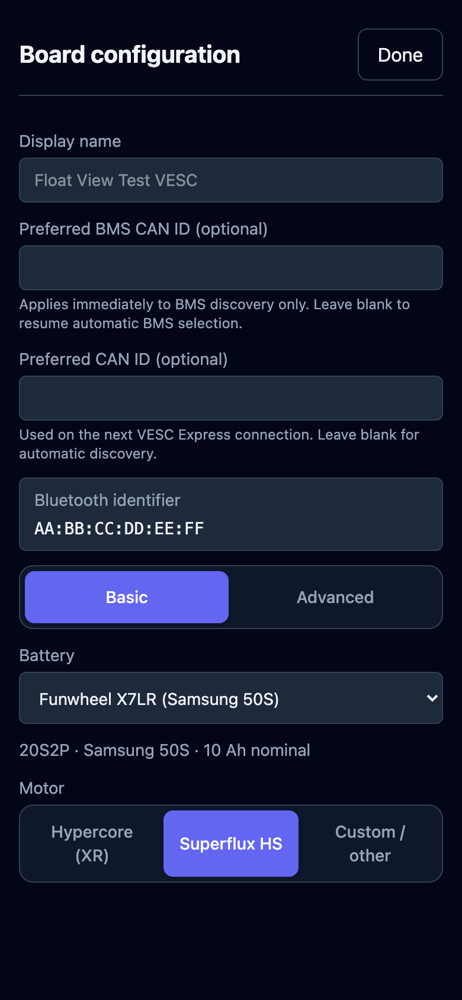
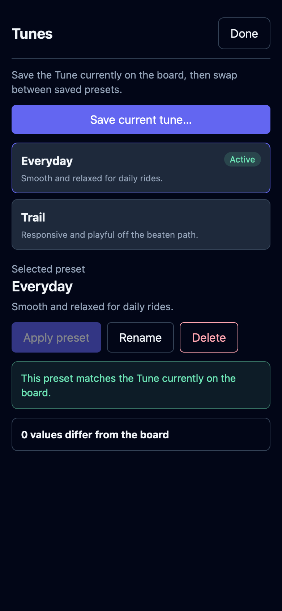

# Float View

Float View is open source under [AGPL-3.0-or-later](LICENSE).
Buying the app through an app store supports ongoing development and helps cover
developer memberships and distribution fees. You can also install through the
alternative routes below or [build it yourself](CONTRIBUTING.md).

Store links will be added here as they become available!

[Privacy policy](PRIVACY.md) · [Support](https://github.com/acheronfail/float-view-mobile/issues)

- 📡 Connect to your VESC board over Bluetooth.
- 📊 Watch live telemetry.
- 🔊 Configurable speed and load announcements.
- 🛞 Record and review rides, including firmware and connection history.
- 🎛️ Configure Refloat, and swap easily between saved tunes.
- 💻 Available on macOS, Android, and iOS (more coming soon).

<table>
  <tr>
    <td align="center" valign="top" width="33%">
      <strong>Live dashboard</strong> 
      
    </td>
    <td align="center" valign="top" width="33%">
      <strong>Live charts</strong> 
      
    </td>
    <td align="center" valign="top" width="33%">
      <strong>Battery management</strong> 
      
    </td>
  </tr>
  <tr>
    <td align="center" valign="top" width="33%">
      <strong>Ride history</strong> 
      
    </td>
    <td align="center" valign="top" width="33%">
      <strong>Board configuration</strong> 
      
    </td>
    <td align="center" valign="top" width="33%">
      <strong>Saved tunes</strong> 
      
    </td>
  </tr>
</table>

## How to install

Download the latest build from the [releases page](https://github.com/acheronfail/float-view-mobile/releases).

### iOS

For now, use [AltStore Classic](https://faq.altstore.io/altstore-classic).

1. Install AltStore Classic using its linked guide (requires a Mac or PC).
2. Download the `.ipa` on your iPhone.
3. In AltStore, open **My Apps**, tap **+**, and select the IPA.

With a free Apple account, [refresh the app every seven days](https://faq.altstore.io/altstore-classic/your-altstore).

### Android

Download the `.apk`, open it on your phone, and tap **Install**.
Allow installation from this source if Android asks.

### macOS

Requires macOS 14 or later. Supports Apple Silicon and Intel.

1. Download the macOS `.zip`, extract it, and move `FloatView.app` to Applications.

## Contributing

See [CONTRIBUTING.md](CONTRIBUTING.md) for development and verification instructions.

## Licence and credits

Copyright © 2025 acheronfail. See [LICENSE](LICENSE) and [NOTICE](NOTICE).
The rider artwork is adapted from [“onewheel” by Luis Prado, Noun Project](https://thenounproject.com/icon/onewheel-4260841/),
under [CC BY 3.0](https://creativecommons.org/licenses/by/3.0/).
Third-party software and artwork retain their own terms; see
[third-party notices](THIRD_PARTY_NOTICES.txt) and [licensing details](docs/licensing.md).
Licences and notices are also available offline in the app's Settings.
